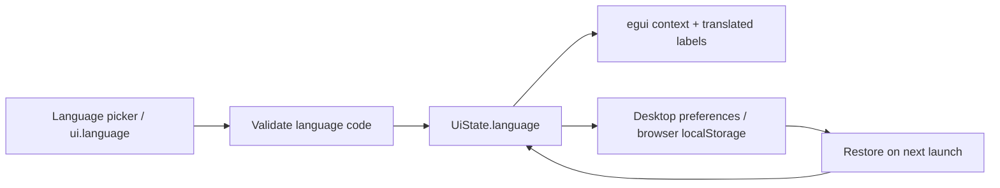

# Interface localization

GridFabrica uses one egui UI on desktop and WASM. Its interface supports English (`en`) and
Simplified Chinese (`zh-CN`). Choose **English / 简体中文** in the title bar; changes apply
without restarting or reopening the workbook. English remains the default for existing installs.

## Domain and rules

- `Language` is a UI preference, not a workbook property. Switching it creates no undo entry and
  never translates cell contents, workbook/sheet names, formulas, format codes or command IDs.
- `UiState.language` persists with desktop preferences. The web shell stores the code in
  `localStorage["gridfabrica.interfaceLanguage"]` and sets the document's `lang` attribute.
  Storage failures keep the choice for the current session and log a warning.
- Unknown saved language codes fall back to English. Commands reject missing/invalid codes
  without changing UI state. Each egui context carries its own language; there is no global locale.
- The English source text is the catalog key. `src/i18n/zh-CN.json` in `ui-egui` contains the
  Chinese catalog. `build_i18n.rs` validates it and generates a static lookup; rendering never
  reads files or parses JSON. Missing translations display their English source.
- `tr(ui, source)` is for interface metadata only. Keep stable IDs and values separate from their
  displayed labels. `Language::format` substitutes named parameters once, preserving user data
  verbatim even when it contains braces. The catalog handles multiline ribbon captions,
  shortcut suffixes and punctuation.



## Agent control

Both `engine.execute` and the direct control method accept the UI command:

```json
{"id":1,"method":"engine.execute","params":{"command":"ui.language","params":{"language":"zh-CN"}}}
{"id":2,"method":"ui.language","params":{"language":"en"}}
```

`ui.inspect` includes `ui.language`; `engine.commands` lists the UI command. `ui.set` also
accepts an optional `language` field. Programmatic switching never opens a dialog.

For file-encoding issues, see [text import and Chinese documents](text-import.md).

## Chinese fonts

Font files remain in `OpenFabrica/craft-fonts`, outside this repository. Build with its pinned
checkout and prepare the additional pinned faces, all under OFL-1.1. Native builds embed the
font data; web builds publish independent static resources:

```sh
python3 packaging/chinese-fonts.py /absolute/path/to/craft-fonts
CRAFT_FONTS_DIR=/absolute/path/to/craft-fonts CRAFT_FONTS_REQUIRED=1 \
  cargo build --release -p gridfabrica
cd apps/gridfabrica-web
CRAFT_FONTS_DIR=/absolute/path/to/craft-fonts CRAFT_FONTS_REQUIRED=1 trunk serve --release
```

Local builds also discover a `craft-fonts` checkout in the repo's ignored directory or beside
the app. An explicit `CRAFT_FONTS_DIR` takes priority; the build never downloads fonts.
Without any checkout, native builds search installed Chinese fonts; WASM uses egui fallbacks
and may lack Chinese glyphs. Web builds intended to display Chinese should use
`CRAFT_FONTS_DIR`. Packaging copies the font licences. Missing requested fonts warn and fall
back, or fail the build when `CRAFT_FONTS_REQUIRED` is set. UI, bold, cell, serif and monospace
families all receive the CJK fallback without changing the workbook's requested font name.

The font selector and Format Cells put available Chinese choices before Latin fonts. Both use
`home.fontName`; aliases retain their requested name in XLSX, while actual faces retain their
canonical upstream family name.

| Choice / imported alias | Display face in the prepared font pack |
|---|---|
| 黑体 / SimHei, 微软雅黑 / Microsoft YaHei, 等线 / DengXian | Noto Sans CJK SC |
| 宋体 / SimSun / NSimSun | Noto Serif CJK SC |
| 楷体 / KaiTi / 楷体_GB2312 | LXGW WenKai (霞鹜文楷) |
| 仿宋 / FangSong / 仿宋_GB2312 | Zhuque Fangsong (technical preview) (朱雀仿宋) |

Common names are **compatibility choices**, not bundled copies of the proprietary fonts. The
selector tooltip identifies the substitute; metrics and glyph shapes can differ from another
reader using the original font. The four open faces also appear as separate choices. Explicit
Chinese faces use their own primary family, including Latin characters, and missing glyphs
fall back to the existing Chinese font. Current supplied faces are Regular; extra bold/italic
font files are not part of this pack. Native hosts with Source Han Serif CN Light installed
also offer that exact face independently of the embedded Noto serif.

`packaging/chinese-fonts.py` explicitly downloads immutable upstream files into the external
craft-fonts checkout, checks SHA-256 for every font and licence, and records them in its manifest
and attribution. Repeated runs verify existing files; mismatched files fail without overwriting.
The release workflows check out craft-fonts at `8dcdacd5153e64560d109541a47d806f26f048c0`, then
run this preparation step before compiling. Cargo itself performs no network downloads. With
`CRAFT_FONTS_REQUIRED=1`, a missing face fails the build. Optional builds can use a partial pack
and list only available choices. Packaging copies all four OFL licence texts.

The WASM target generates **no `include_bytes!` font data** and disables egui/eframe
`default_fonts`. The externally loaded fonts supply Latin and Chinese glyphs. Native targets
still enable egui defaults. It contains a small list of relative
resource URLs and expected sizes. A Trunk post-build hook verifies each file against the shared
manifest and copies the four full fonts and their licences into `dist/web/fonts/`, with SHA-256
in every font filename. Native targets keep the embedded font path unchanged.

The Rust browser shell fetches these same-origin resources concurrently before starting egui.
Requests time out after 30 seconds; HTTP and exact-length failures are reported and other faces
continue to load. The UI accepts only known font IDs, validates font headers and caps each
resource at 64 MiB before registering it. If no font can be loaded, the DOM loading screen shows a retry instruction instead of starting
an empty egui font set. Runtime fonts are scoped to the egui context and survive
its repeated setup, so a new workbook or redraw cannot discard them. Changing fonts updates
workbook styles through the existing commands. Browser caching reuses the separate font files;
content changes select new resource URLs. Independent font files still require roughly 71 MiB
before transfer compression, but these bytes no longer enlarge or require compiling the WASM.
See [web hosting](../packaging/web/README.md) for MIME, compression and caching configuration.

## Extending and testing

To add a locale, extend `Language` (code/name/parser), add its catalog and static lookup to the
build script, and update the documentation. Translate UI metadata at rendering boundaries;
never move locale dependencies into the spreadsheet engine.

Run `cargo test -p gridfabrica-ui-egui`, `cargo check -p gridfabrica`, and `cargo xtask wasm`.
The startup clock regression also runs on real WASM (Node.js):

```sh
CARGO_TARGET_WASM32_UNKNOWN_UNKNOWN_RUNNER=wasm-bindgen-test-runner \
  cargo test -p gridfabrica-engine --target wasm32-unknown-unknown --test browser_clock
```

Use a `wasm-bindgen-test-runner` matching the lockfile's wasm-bindgen version.
Interaction tests click the language picker, check translated dialog labels and stable IDs,
round-trip old/new preferences, reject invalid commands, render all ribbon tabs and exercise
Chinese text input. Set `GRIDFABRICA_I18N_SHOTS=/existing/output/directory` to emit comparison
PNGs from the Chinese UI test. Native OS IME composition and browser persistence require live
platform validation; the text-event test alone does not prove those paths.

The interface catalog covers the application chrome, menus, common dialogs and task panes.
Engine diagnostic errors, formula help descriptions, raw JSON inspection and native OS file
picker wording retain their source/system language in this first version.
