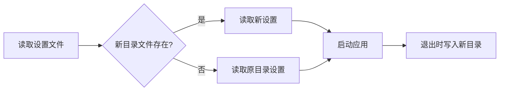

# 项目命名与迁移

本仓库由 GridCraft 改名为 GridFabrica，维护地址为
<https://github.com/OpenFabrica/gridfabrica>。表格模型、文件格式和命令 ID 不受改名影响。

| 用途 | 名称 |
| --- | --- |
| 窗口、菜单、关于、文档及安装程序 | `GridFabrica` |
| 桌面程序 / CLI / Web | `gridfabrica` / `gridfabrica-cli` / `gridfabrica-web` |
| Cargo 包 / Rust 引用 | `gridfabrica-*` / `gridfabrica_*` |
| 应用 ID | `ai.storyteller.gridfabrica`（保留原 namespace） |
| 环境变量 | `GRIDFABRICA_*` |

## 设置和调用迁移

桌面设置现在写入 macOS 的 `~/Library/Application Support/GridFabrica/`、Windows 的
`%APPDATA%\GridFabrica\` 或 Linux/BSD 的 `$XDG_CONFIG_HOME/gridfabrica/`
（未设置 XDG 时使用 `~/.config/gridfabrica/`）。当新目录中的设置文件不存在时，按文件读取原
`GridCraft` / `gridcraft` 目录；不移动或覆盖原文件。新设置和原目录的读取错误不会被旧设置覆盖。

脚本、MCP 配置及外部 Cargo 消费方需要更新程序名、包名和应用 ID。桌面启动兼容
`GRIDCRAFT_CONTROL_PORT`、`GRIDCRAFT_NO_PREFS` 和 `GRIDCRAFT_NO_NATIVE_MENU`；新配置使用
`GRIDFABRICA_*`。MCP 发现接口公布 `gridfabrica://` 资源，读取接口继续接受对应的
`gridcraft://workbook`、`gridcraft://commands` 和 `gridcraft://functions` 别名。

Web 使用 `gridfabrica.interfaceLanguage` 保存界面语言；新键缺失或非法时，读取有效的
`gridcraft.interfaceLanguage` 并复制到新键，保留旧键。存储失败不改变当前会话的语言选择。
Windows MSI 保留原 UpgradeCode，以维持原有升级系列。macOS 和 Flatpak 的应用 ID 已改名，
原版可与新应用并存；此项不代表原版安装程序的卸载或系统文件关联已自动迁移。

## 原作者记录

原 MIT 版权声明、资产原作者、生成的贡献者记录和品牌许可条文保留历史名称。
ArtCraft 商标素材和原团队宣传从当前项目中移除；开放许可的表格图标继续使用并保持归属记录。

## 验证

运行 `cargo xtask ci`，并检查 `gridfabrica --version`、`gridfabrica-cli --version`、CLI 公式求值、
MCP 初始化及当前构建生成的离屏截图。改名后的安装程序仍需在各目标系统验收。
