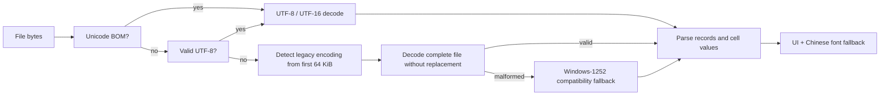

# Text import and Chinese documents

Chinese spreadsheet documents can contain Unicode text or legacy Chinese byte encodings. The
reader must preserve the decoded cell values; UI language and font fallback are separate concerns.

## Supported paths

- XLSX/XLSM: XML Unicode strings (shared strings, inline strings and rich-text runs). XML escapes
  are decoded as spreadsheet text. UI localization never translates workbook contents.
- CSV/TSV/TXT: UTF-8 (with or without BOM), BOM-marked UTF-16 LE/BE, and detected legacy
  encodings including GBK/GB18030 and Big5. Western files continue to decode with their detected
  encoding. Text imports are limited to 128 MiB to bound decoder/parser allocations on WASM too.

`crates/xlsx/src/csv.rs` owns text decoding. `chardetng` identifies legacy encodings and
`encoding_rs` decodes them. The detector sample is capped; a partial sample is not marked final,
so a multibyte character split at the sample boundary is not treated as a truncated document.
UTF-8 and explicit BOMs have priority over statistical detection. A malformed legacy guess keeps
the old Windows-1252 fallback instead of silently substituting replacement characters.

The browser file picker, drag/drop, desktop Open and agent `file.open` all reach
`engine::io::open_bytes` and the same `read_csv` implementation. There are no platform-specific
byte-to-string conversions in the UI.

## Diagnosis and limitations

- Text like `Ãû³Æ` in place of `名称` indicates an encoding error. Inspect engine cell values;
  changing fonts cannot repair wrongly decoded bytes.
- Square glyphs while engine values are correct indicate a missing font. Build the web app with
  `CRAFT_FONTS_DIR`; see [interface localization](localization.md).
- Statistical detection can be ambiguous for very short/mixed-encoding files. UTF-8 with a BOM
  is the most explicit interchange format. This change cannot recover files whose contents were
  already saved as mojibake, and it does not add support for the binary `.xls` format.

Run `cargo test -p gridfabrica-xlsx` and `cargo test -p gridfabrica-engine --test chinese_import`.
Tests cover GBK and GB18030 (including four-byte characters), Big5, UTF-8/BOM, UTF-16 LE/BE,
Western text, malformed input, Unicode XLSX and the full browser-style `file.open` byte path.
Use synthetic documents for live browser import checks; no third-party sample files are committed.
